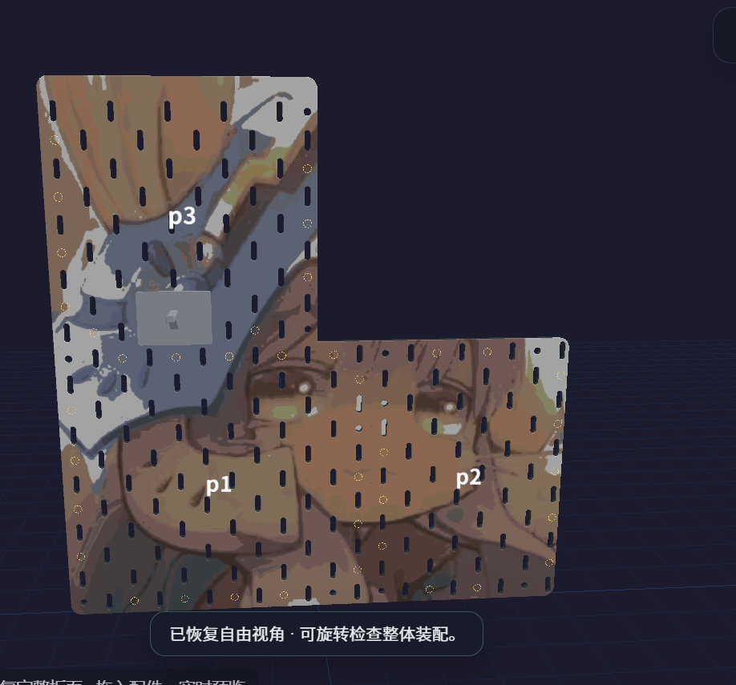
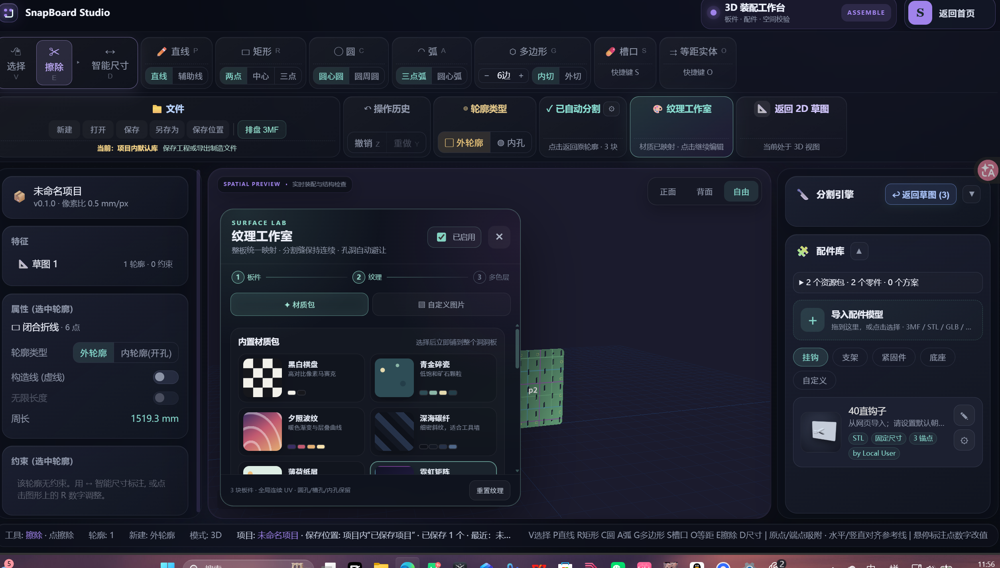
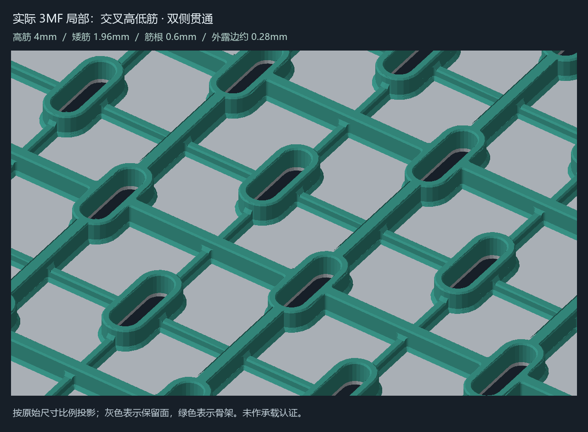
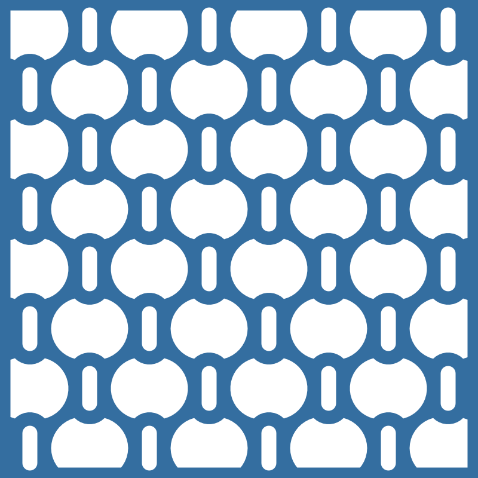
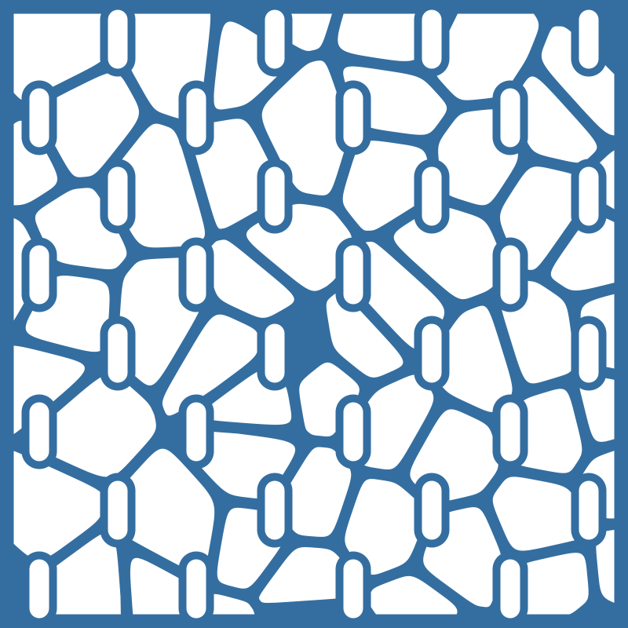

# SnapBoard

**把一张草图，变成可以打印的专属洞洞板。**

2D 画板 · 参数化分板 · 图案叠色 · 镂空骨架 · 多盘 3MF

[**下载个人玩家版**](https://github.com/Ruoshui1145/snapboard/releases/tag/v1.3.2-diy.1) · [使用指南](docs/GETTING_STARTED.md) · [更新日志](CHANGELOG.md) · [问题反馈](https://github.com/Ruoshui1145/snapboard/issues) · [官网](https://snapboard.cn/)

图案映射与分板效果的软件渲染。这里展示的是设计结果，不是实物打印照片。

## 从想法到制造文件

1. **画板型**：矩形、圆弧、槽口或自定义轮廓，标注尺寸，按热床范围自动分板。
2. **放图案**：导入图片或 SVG，拖动、缩放、旋转、镜像，选择适合自己的纹理与材料档案。
3. **选结构**：完整板、完全镂空、保留正面薄层或图案区托底；选择圆润连筋、Voronoi、斜撑、细分蜂窝或交叉高低筋。
4. **检查并导出**：查看板厚、孔位与装配，保存可编辑的 .snapboard 工程，导出多对象、多盘或分板 3MF，再交给自己的切片软件。

工程、图片和几何计算优先留在本机。个人玩家版向服务器交换设备签名及导出额度凭据，**不上传图纸、原图或制造文件**。

## 设计效果展示

| 纹理工作室 | 交叉高低筋 |
| :---: | :---: |
|  |  |
| 图片与板面映射、材料与颜色处理 | 正面承托、背面交叉筋、孔边与连接过渡 |

| 圆润连接 | 不规则连接 |
| :---: | :---: |
|  |  |
| 连筋共同形成连续网架 | Voronoi 风格的大通窗与连续骨架 |

以上包含软件截图、结构平面图和模型渲染；具体效果以所选参数的预览、切片与实打为准。示例图案的权益归原权利人，不能因为软件开源而获得图片或第三方模型的再分发许可。[图片来源与说明](docs/assets/showcase/README.md)。

## 个人玩家版怎么用

- 下载 Release 中的 **SnapBoard-DIY-Setup-1.3.2-diy.1-x64.exe**，适用于 Windows 10/11 x64；运行环境随安装包提供。
- 首次使用需要联网取得设备绑定的签名额度；**每个设备每天 10 次完整制造导出，按北京时间零点更新**。多盘或分板任务合计一次，重复领取同一任务不会再扣一次。
- 编辑、预览和保存工程不计次数。取消或保存失败释放预留次数；保存成功后记录完成，重启不会重置当天次数。
- 每天取得新额度需要联网。当天已经签发的有效额度可继续使用，失效或校验失败时保留工程和历史文件。
- 初始包不包含个人及第三方 Private 配件集合，可在设置中导入自己的 STL、3MF、GLB、GLTF 或 .sbpack。

[详细额度规则与隐私说明](docs/PERSONAL_EDITION.md) · [安装、迁移与排障](docs/GETTING_STARTED.md)。本仓库发布个人玩家版；农场订单后台与私有运维资料另行维护。

## 这次更新

- 整理板材设计、纹理工作室与镂空结构操作，加入 SVG 轮廓导入和图案区托底。
- 保留正面与背部减材，加入交叉高低筋、细分蜂窝、连接过渡及孔口处理。
- 修复切换骨架时旧任务干扰、贴图资源交接、重播迟到模型以及旧草图求解结果回写。
- 加入界面品牌水印与制造文件来源编号，恢复本次个人版所需的每日 10 次导出规则。

[完整公开更新日志](CHANGELOG.md)。精细倒角仍可能需要等待；几何检查通过不等于实物承重认证。

## 源码与贡献

使用 Node.js 24，在仓库根目录执行：

~~~powershell
npm ci
npm run dev
npm run build:diy
npm run verify:diy
~~~

日常设计使用安装版即可。源码自建需要自己提供与固定公钥匹配的可信额度服务；公开仓库没有服务器私钥或运营凭据。安装包的内部发行签名由维护者制作，未签名的发行资源不会作为可信安装版启动。

| 目录 | 用途 |
| --- | --- |
| snapboard-v2/ | 草图、板件、纹理、镂空、装配与制造 |
| desktop/ | 个人玩家版桌面壳与构建脚本 |
| apps/merchant-license/ | 设备签名、每日额度和本地保护存储客户端 |
| apps/wiki/ | 保留的公开使用资料与开发日志 |
| docs/ | 当前使用说明、公开变更记录与展示素材 |
| vendor/ | 固定第三方运行模板及来源声明 |

报告问题时请提供版本、Windows 版本、复现步骤和截图；有需要时提供已移除私密素材的最小工程。欢迎通过 Issue 和 Pull Request 改进项目。

## 许可与来源

SnapBoard 自有软件代码使用 [GPL-3.0-only](LICENSE)。组合版本中的 Lumina Layers 代码、LUT 和运行模板保留原 GPLv3 来源与修改说明，见 [THIRD_PARTY_NOTICES.md](THIRD_PARTY_NOTICES.md)。安装包附对应源码快照。

软件许可证不覆盖用户图案、字体和第三方配件模型的独立权利。模型可打印性、颜色和配合尺寸需要结合自己的材料、喷嘴与打印方向检查。
